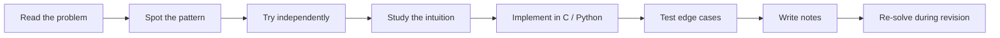
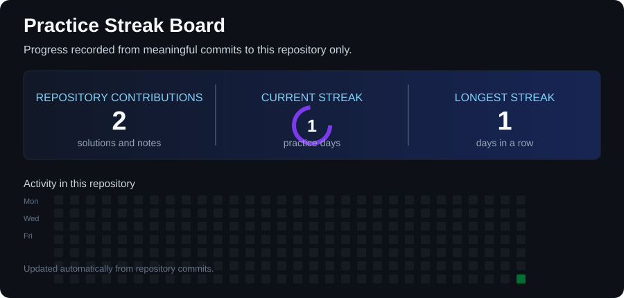

<div align="center">


</div>

---

## 🧭 What is this?

This is a visual, pattern-wise collection of **385 Data Structures and Algorithms problems** from the [RisingBrain Pattern-Wise DSA Sheet](https://risingbrain.org/sheet/pattern-wise-sheet).

Every problem is paired with:

```text
🧠 Intuition       →  Why does this approach work?
🛠️ Implementation  →  How is it written in C and Python?
📈 Complexity      →  What are the time and space costs?
🧪 Edge Cases      →  What can break the solution?
🔁 Revision Notes  →  What should be remembered?
```

The goal is simple: make solutions useful for **learning, interview preparation, and fast revision**—not just code to copy.

## 🗺️ Pattern Map

| Pattern                 |      Problems |            Explore            |
| ----------------------- | ------------: | :---------------------------: |
| 🧱 Arrays               |            24 |        [Open](./Array/)        |
| 🔤 Strings              |            11 |       [Open](./Strings/)       |
| 🔍 Binary Search        |            23 |    [Open](./Binary-Search/)    |
| 📚 Stack                |            32 |        [Open](./Stack/)        |
| 🚶 Queue                |             6 |        [Open](./Queue/)        |
| ♻️ Recursion          |            20 |      [Open](./Recursion/)      |
| 🔗 Linked List          |            29 |     [Open](./Linked-List/)     |
| ↔️ Doubly Linked List |             9 | [Open](./Doubly-Linked-List/) |
| 🗃️ HashMap            |             5 |       [Open](./HashMap/)       |
| 🌳 Binary Tree          |            54 |     [Open](./Binary-Tree/)     |
| 🕸️ Graph              |            43 |        [Open](./Graph/)        |
| ⛰️ Heap               |            16 |        [Open](./Heap/)        |
| 🧩 Backtracking         |            24 |    [Open](./Backtracking/)    |
| 🎯 Greedy               |            18 |       [Open](./Greedy/)       |
| 🧮 Dynamic Programming  |            44 | [Open](./Dynamic-Programming/) |
| 🔠 Trie                 |            11 |        [Open](./Trie/)        |
| 🔢 Bit Manipulation     |            16 |  [Open](./Bit-Manipulation/)  |
| **🏁 Total**      | **385** |                              |

<details>
<summary><b>See the learning path</b></summary>



</details>

## 📁 Repository Structure

Each problem gets one folder containing a shared explanation and, where available, both implementations.

```text
DSA/
├── README.md
├── Array/
│   └── Two-Sum/
│       ├── solution.c
│       ├── solution.py
│       └── notes.md
├── Strings/
├── Binary-Search/
├── Stack/
├── Queue/
├── Recursion/
├── Linked-List/
├── Doubly-Linked-List/
├── HashMap/
├── Binary-Tree/
├── Graph/
├── Heap/
├── Backtracking/
├── Greedy/
├── Dynamic-Programming/
├── Trie/
└── Bit-Manipulation/
```

> The folder and file names in the example illustrate the convention. They will appear as problems are added.

## 💻 Languages

| Language         | Why it is included                                                                           |
| ---------------- | -------------------------------------------------------------------------------------------- |
| **C**      | Pointers, memory management, arrays, structures, and low-level data-structure implementation |
| **Python** | Concise algorithm expression and practical use of built-in data structures                   |

Both implementations follow the same core algorithm whenever that makes sense. Language-specific differences are noted where they affect the solution.

## 📝 Problem Notes Standard

Every `notes.md` aims to answer the questions a learner has while revising:

```markdown
# Problem Name

- Problem link:
- Pattern:
- Difficulty:
- Languages:

## Problem Summary
The problem in simple words.

## Intuition
The observation that unlocks the solution.

## Approach
1. ...
2. ...
3. ...

## Complexity Analysis
- Time: O(...)
- Auxiliary space: O(...)

## Edge Cases
- ...

## Key Takeaways
The pattern and ideas worth remembering.
```

Code is kept readable and the explanation focuses on **why** the algorithm works, not on comments for every line.

## 🔍 How to Use This Repository

```text
1️⃣ Pick a pattern
      ↓
2️⃣ Try the problem without opening the solution
      ↓
3️⃣ Read the intuition and trace the example
      ↓
4️⃣ Study the C / Python implementation
      ↓
5️⃣ Close the notes and code it yourself
      ↓
6️⃣ Revisit it using the key takeaways
```

This repository works well for:

- Topic-wise DSA learning
- Coding interview preparation
- Last-minute pattern revision
- Comparing C and Python implementations
- Understanding common edge cases and complexity trade-offs

## 🔥 Practice Streak Board

Consistency beats intensity. Use this lightweight board to record focused practice sessions without turning preparation into a race.

<div align="center">



</div>

This tracker is intentionally **repository-specific**: a practice day counts only when this repository receives a meaningful solution, note, or revision commit. It does not represent activity across the account.

## 🌱 Mindset

> **“TRUST THE PROCESS”** - **M. S. Dhoni 🏏**

<div align="center">


</div>

<div align="center">


</div>

## 🤝 Contributions

Suggestions and improvements are welcome. Contributions can include:

- Correcting an implementation or explanation
- Improving readability or complexity
- Adding missing edge cases
- Providing an alternative approach
- Fixing documentation or navigation

Please keep contributions accurate, beginner-friendly, and consistent with the notes format.

## 🔗 Source and Practice

- 📚 [RisingBrain Pattern-Wise DSA Sheet](https://risingbrain.org/sheet/pattern-wise-sheet)
- 💻 [LeetCode](https://leetcode.com/)

---

<div align="center">

</div>
